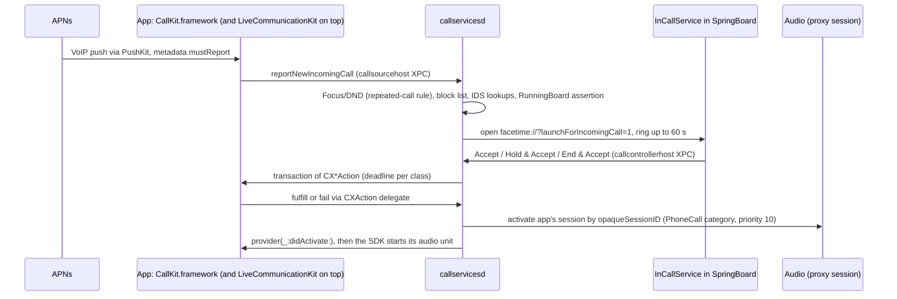
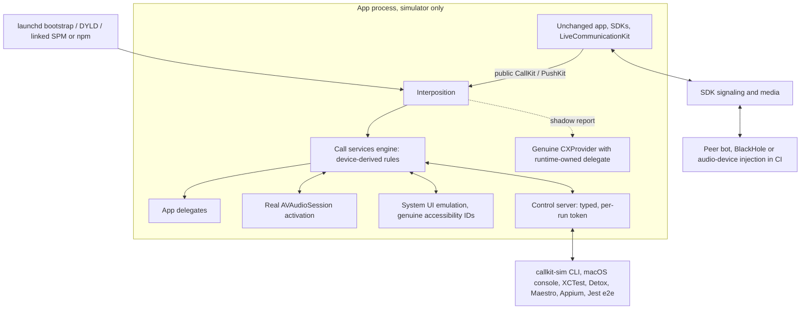

# CallKit Simulator: discovered plan (v2)

October 20, 2026. Evidence from the simulator (iOS 27.0 locally, iOS 26.5 on GitHub's hosted runners), the iPhone 13 (iOS 27.0, 24A5355q) and a working runtime prototype. No package code is published yet. Target repository: `ziahamza/callkit-simulator`.

This is one of two products. The companion [calling library plan](2026-10-20-calling-library-plan.md) turns the same evidence into a Swift and React Native library with WebRTC add-ons; its reference apps are this simulator's conformance subjects.

Everything below links to saved traces (simulator, device, CI and real APNs) in [`callkit-simulator-probe/`](callkit-simulator-probe/README.md). "Measured" means a run produced it; "proposed" means it is design.

## Recommendation

Build an in-process stand-in for `callservicesd` behind CallKit's public API, active only in simulator builds. Unchanged apps, and SDKs that call CallKit internally, then get a working call lifecycle in any simulator. That includes LiveCommunicationKit, which turned out to be built on `CXProvider`. The prototype already does this:

- The unmodified probe app behaves like the iPhone 13 across ringing, answer, hold, swap, merge, DTMF, the error codes, the 60 s answer deadline and audio activation.
- A standard WebRTC app goes from **0 RTP packets** on genuine simulator CallKit to **about 50 packets per second** flowing from one in-process peer to the other with the runtime injected. That is one direction; two-way evidence is a milestone gate.
- The same results hold on a GitHub `macos-26` runner.
- Real sandbox APNs pushes work too, including cold launches, when the runtime also reports to genuine CallKit. The simulator enforces PushKit's reporting rule inside the app, so interposition alone gets the app killed.

Around the runtime, ship:

- an emulated system call UI with the **same accessibility identifiers as iOS**, so UI tests written against a real iPhone run unchanged in the simulator;
- a typed control plane and CLI for tests and manual QA;
- fault injection for failure modes iOS produces on real devices but never on demand;
- a conformance suite that replays the same scenarios on the iPhone 13.

## 1. Evidence ledger

### Why genuine CallKit fails in the simulator

| #   | Finding                                                                                                                                                                                                                                                                                                                                                                                                                              | Evidence                                                                                      |
| --- | ------------------------------------------------------------------------------------------------------------------------------------------------------------------------------------------------------------------------------------------------------------------------------------------------------------------------------------------------------------------------------------------------------------------------------------ | --------------------------------------------------------------------------------------------- |
| S1  | Every call the daemon wants to show is torn down 65–250 ms after it's reported or started. `callservicesd` opens `facetime://?launchForIncomingCall=1` or `?showInCallUI=1`, LaunchServices fails (115) because `InCallService.app`/`MobilePhone.app` are absent and `FaceTime.app` is a stub, then it logs "Disconnecting call because there wont be a UI to host the call" (reason 55) and sends the provider a `CXEndCallAction`. | `sim-ios27-callservicesd-excerpts.log`; CI `macos-26` (iOS 26.5): 7 such disconnects          |
| S2  | `provider(_:didActivate:)` never fires. `AVAudioSession.opaqueSessionID` is **0** in the simulator (the iPhone reports 475156 and up), so the daemon's proxy activation with the private `PhoneCall` category fails with `OSStatus -50`.                                                                                                                                                                                             | Local and CI                                                                                  |
| S3  | Apple DTS confirms the same mechanism on devices: a missing `didActivate` is `callservicesd` holding an invalid audio session ID. Their workaround is `setConfiguration` before reporting, or recreating the provider.                                                                                                                                                                                                               | [Forum thread 837211](https://origin-devforums.apple.com/forums/thread/837211) (iOS 27 betas) |
| S4  | The daemon requires an `application-identifier` entitlement. Without one it rejects the call source and **crashes** on the next controller request.                                                                                                                                                                                                                                                                                  | Probe run 1 crash report                                                                      |
| S5  | `CXCallController` requests need the `voip` background mode. Without it the daemon logs `hasVoIPBackgroundMode=0` and returns `unentitled` (1). Xcode silently ignores `INFOPLIST_KEY_UIBackgroundModes`.                                                                                                                                                                                                                            | Media probe                                                                                   |
| S6  | Genuine LiveCommunicationKit fails the same way (the system sends `EndConversationAction`), with errors in the **CallKit** domain.                                                                                                                                                                                                                                                                                                   | `runtime-spike/runs/sim-genuine-lck.log`                                                      |
| S7  | The simulator gets a genuine 80-byte VoIP PushKit token. `simctl push` explicitly does not support VoIP pushes.                                                                                                                                                                                                                                                                                                                      | Push probe; `simctl push --help`                                                              |
| S8  | Hosted runners deliver microphone frames but they're silent (peak 0). Xcode 26.3's SDK lacks `PKVoIPPushMetadata` (iOS 26.4 API).                                                                                                                                                                                                                                                                                                    | CI run 39481703479                                                                            |

### What a real iPhone does (the oracle)

| #   | Behavior on iPhone 13, iOS 27.0                                                                                                                                                                                                                                                                                                                                                                                                                                                                          | Evidence                                             |
| --- | -------------------------------------------------------------------------------------------------------------------------------------------------------------------------------------------------------------------------------------------------------------------------------------------------------------------------------------------------------------------------------------------------------------------------------------------------------------------------------------------------------- | ---------------------------------------------------- |
| D1  | Report accepted in about 1.1 s; observer change just before the completion handler. **Unanswered calls are ended by the system after 60.1 s** (7 calls, 60.08–60.13 s).                                                                                                                                                                                                                                                                                                                                  | `iphone13-*`, `device-system-ui/*`                   |
| D2  | Request completion arrives before `perform`. Default deadlines: start 600 s, answer 60 s, everything else 5 s.                                                                                                                                                                                                                                                                                                                                                                                           | Full scenario                                        |
| D3  | `didActivate` 290–530 ms after an answer is fulfilled, and 228 ms after a start is fulfilled (before connected). Holding the only active call → `didDeactivate`; unholding → `didActivate`. Last call ends → `didDeactivate` 0.1–1.15 s later.                                                                                                                                                                                                                                                           | Full scenario, call waiting                          |
| D4  | An app may answer only when no other call exists. Answering a waiting call from the app returns `invalidAction` (6), whether alone, after a hold, with a hold, or as End & Accept.                                                                                                                                                                                                                                                                                                                       | `answer-rules`                                       |
| D5  | System call-waiting choices, each one transaction performed in order: **Hold & Accept** `[CXSetHeldCallAction(active, true), CXAnswerCallAction(waiting)]`; **End & Accept** `[CXEndCallAction(active), CXAnswerCallAction(waiting)]`; **Decline** `[CXEndCallAction(waiting)]`, leaving the active call alone. After either accept, `didDeactivate` then `didActivate` follow 150–230 ms apart.                                                                                                         | `device-system-ui/…ui6-app.jsonl`, `…ui10-app.jsonl` |
| D6  | Answer never completed: no timeout callback; the system sends `CXEndCallAction` at 59.6 s, and the answer stays in `pendingTransactions`. End never completed: `timedOutPerforming` at 5.2 s, then the call ends. Failed answer or start ends the call; failed mute does not.                                                                                                                                                                                                                            | `failures`, full scenario                            |
| D7  | The system sends its own actions (`CXSetMutedCallAction` during hold sequences and after calls end). Completing an action for an already-ended call is ignored and times out after 5 s.                                                                                                                                                                                                                                                                                                                  | Full scenario                                        |
| D8  | Lock screen (no passcode): an `Accept` **button** in SpringBoard, not a slider. The answer action arrives 0.9 s after the tap.                                                                                                                                                                                                                                                                                                                                                                           | `ui6`                                                |
| D9  | A Focus on the phone (probably shared from another device) filters calls with `FilteredByDoNotDisturb` (3) after about 3.2 s. **A second call from the same number within seconds breaks through**, iOS's "repeated calls" rule.                                                                                                                                                                                                                                                                         | `ui4`, `ui6`, remote-end run                         |
| D10 | Genuine UI accessibility: banner `Accept` (label "Answer call") and `Decline`; call waiting `Hold & Accept`, `End & Accept`, `Decline`, `Remind Me`; in-call `Speaker`, `Video`, `Mute`, `More`, `End`, `Keypad`; caller text `PHMarqueeView`, status `PHSingleCallParticipantLabelView_StatusLabel` ("<App> Audio…").                                                                                                                                                                                   | `genuine-call-ui-accessibility.txt`                  |
| D11 | Automating the genuine UI is fragile. The banner lives in InCallService but is only tappable through SpringBoard's query, whose snapshot omits it. InCallService frames are scene-local, and transiently one-third scale during transitions.                                                                                                                                                                                                                                                             | `ui*-xcuitest.txt`                                   |
| D12 | Automating the genuine UI: SpringBoard element queries work for the banner and the lock-screen Accept. Call-waiting buttons work only as InCallService **element** taps; three coordinate taps computed from their frames did nothing (`ui7`). After a lock-screen answer, element taps on InCallService's Mute, Keypad, Speaker and End produced **no** CallKit action, so the visible in-call controls likely live in another host (unresolved). UI automation cannot start while the phone is locked. | `ui7`, `ui10`                                        |
| D13 | **One provider per process receives every action** (iPhone 13, iOS 27.0, October 21). The most recently *created* `CXProvider` gets all `CXCallController` actions, including answer, mute and end for calls an earlier provider reported, and the audio callbacks. Configuration and supported handle types do not matter. A new provider without a delegate takes over, and actions sent to it are lost; setting the delegate later does not replay them. Releasing it without `invalidate` keeps it active. After invalidating it, the earlier provider does **not** take over: requests fail with `unknownCallProvider` (2) after about 10.6 s, although the earlier provider can still report incoming calls. Reporting from the invalidated provider revives it (`providerDidBegin`). | `provider-routing/` |
| D14 | **System mute actions.** Each app-requested `CXSetMutedCallAction` is followed 10–17 ms later by a second, system-originated one with the same value. Ending a muted call delivers a system unmute after the end action, which reports a timeout at its 5 s deadline (5.0–5.9 s) even though the app fulfilled it. | `provider-routing/` |

### Real APNs on the simulator

Phone's VoIP Services certificate (`com.ziahamza.phoneapp`, team `85A9MS6428`) sent eight sandbox pushes to a probe installed under Phone's bundle ID in a throwaway iOS 27.0 simulator. All returned HTTP 200. Evidence: [`apns-real/`](callkit-simulator-probe/apns-real/).

| #   | Result                                                                                                                                                                                                                                                                                                                                               |
| --- | ---------------------------------------------------------------------------------------------------------------------------------------------------------------------------------------------------------------------------------------------------------------------------------------------------------------------------------------------------- |
| P1  | Pushes arrive through the iOS 26.4 metadata API. `mustReport` was **false** while the app was active or inactive and **true** on a cold launch. **Corrected October 21:** `applicationState` does not decide it. A running app backgrounded for 25 s (state 2) got **false** and survived without reporting (E9); on October 20 a backgrounded app got true. Apple's header lists foreground, an existing active call and late delivery as cases for false.                                                                                                                                      |
| P2  | **The simulator enforces the reporting rule, inside the app process.** With `mustReport` true and no report, calling the completion handler raises `NSInternalInconsistencyException`: "Killing app because it never posted an incoming call to the system after receiving a PushKit VoIP push."                                                     |
| P3  | **Interposition alone is not enough.** With the runtime injected and no shadow report, the app reported (to the runtime) and was still killed. PushKit's check needs a genuine CallKit report.                                                                                                                                                       |
| P4  | **Runtime plus shadow report passes.** Background and cold launch both survive; the runtime keeps the call ringing while the daemon's reason-55 teardown goes only to the runtime's delegate.                                                                                                                                                        |
| P5  | **Cold launch works end to end.** A real push launched the terminated app in the background and delivered 154 ms after process start. With the launchd bootstrap, the runtime was in place before app code (`injected: true`); the app was still alive 40 s later.                                                                                   |
| P6  | `callservicesd` grants a RunningBoard **VoIP assertion** (`PreventTaskSuspend`, `WantsForegroundResourcePriority`) for a genuine call and drops it at teardown. RunningBoard then logs "Ignoring suspend because this process is simulated and has background audio capability": the simulator never suspends apps with the `audio` background mode. |
| P7  | PushKit must be registered during app initialization. A background launch for a push creates no UI scene, so a SwiftUI `.task` never runs. Genuine reports take 1.2–3.5 s in the simulator.                                                                                                                                                          |

### What the prototype proves

The runtime prototype is about 450 lines of Objective-C: [`CKSimRuntime.m`](callkit-simulator-probe/runtime-spike/CKSimRuntime.m), [`CKSimPush.m`](callkit-simulator-probe/runtime-spike/CKSimPush.m) and [`CKSimBootstrap.c`](callkit-simulator-probe/runtime-spike/CKSimBootstrap.c).

| #   | Result                                                                                                                                                                                                                                                                                                                                                       | Evidence                                         |
| --- | ------------------------------------------------------------------------------------------------------------------------------------------------------------------------------------------------------------------------------------------------------------------------------------------------------------------------------------------------------------ | ------------------------------------------------ |
| R1  | The unmodified probe in the simulator matches the device: calls ring and survive, answer, hold/unhold with deactivate/activate, call-waiting `invalidAction` (6), merge, the same error codes (4, 4, 1), and an unfinished answer ended at 59.66 s (device 59.58 s) and left pending.                                                                        | `runtime-spike/runs/sim-runtime-full.log`        |
| R2  | `CXCall` objects for the observer can be built with the private `initWithUUID:` plus key-value setters. They are genuine `CXCall` instances, but equality and copy behavior still need checking against the system's. Genuine `CX*Action` instances reach the app's delegate; completion is intercepted through `fulfill`, `fail` and `fulfill(withDate…:)`. | R1 run, `sim-hooks.log`                          |
| R3  | **WebRTC A/B in one unmodified app.** Genuine: call accepted, no `didActivate`, **0 packets**. Runtime: `didActivate` at 400 ms, one stream (caller to callee) at about 50 packets per second, 48,000 decoded samples per second, non-zero mic level.                                                                                                        | `sim-genuine-media.log`, `sim-runtime-media.log` |
| R4  | **LiveCommunicationKit comes free.** `ConversationManager` registers a `CXProvider` internally, so report, join, `didActivate`, end and `didDeactivate` all run through the engine.                                                                                                                                                                          | `sim-runtime-lck.log`                            |
| R5  | Synthetic VoIP push into an unchanged delegate through the iOS 26.4 API: `pushRegistry:didReceiveIncomingVoIPPushWithPayload:metadata:withCompletionHandler:`, with `mustReport` true. Note there is no `forType:` in that selector; a Swift signature that adds `for:` compiles silently and is never called.                                               | `sim-runtime-push-shadow.log`                    |
| R6  | **Shadow report isolation.** The genuine `CXProvider` gets a runtime-owned delegate; the real report is accepted (1.5 s); the daemon's reason-55 teardown reaches only that delegate while the app's call keeps ringing.                                                                                                                                     | Same log                                         |
| R7  | **Launchd bootstrap injection.** A 30-line bootstrap set in the simulator's launchd environment loads the runtime only into named bundle IDs, for every launch path: SpringBoard, XCUITest, Detox, Maestro, Appium, a push cold launch. Software Mansion's Argent devtools uses the same mechanism.                                                          | Bootstrap run                                    |
| R8  | GitHub `macos-26` (Xcode 26.6, iOS 26.5): genuine fails as in S1–S2; the runtime matches the device; the synthetic push works.                                                                                                                                                                                                                               | `ci-github-run-39481703479/`                     |

## 2. How CallKit actually works

What a replacement must reproduce is everything an app can observe:

- request results with Apple's error domains and codes;
- delegate callbacks with their ordering and queues;
- per-class deadlines and the different expiry behavior for answer versus other actions;
- system-originated actions and transactions;
- observer states;
- audio activation timing relative to completion, hold and end;
- ring timeout, filtering and lifecycle effects.

The daemon also does things no app-side runtime can: RunningBoard assertions (moot in the simulator, P6), telephony audio priority, real lock-screen presentation, cross-app arbitration. These remain documented gaps.

## 3. Architecture

### Decisions

1. **The seam is CallKit's own API.** Interpose `CXProvider`, `CXCallController`, `CXCallObserver` and `CXAction` completion, and deliver to `PKPushRegistry` delegates. LiveCommunicationKit is covered through `CXProvider` (R4).
2. **One runtime binary, three activation routes:**
   - **launchd bootstrap**, the default for local and CI: covers every launch path and test framework, including push cold launches;
   - **per-launch `DYLD_INSERT_LIBRARIES`**: through `simctl` or XCUITest `launchEnvironment`;
   - **linked** SPM/npm product, auto-active in simulator builds: for hosts where the simulator's environment can't be set (Xcode Cloud, EAS).

   Every receipt records which route was used. Device slices contain no runtime code.

3. **The rules come from the device.** The engine encodes D1–D9 as data: deadlines, validation, `invalidAction` for app-answered waiting calls, the 60 s ring timeout, system-composed Hold & Accept and End & Accept transactions, audio activation points, and expiry semantics. It also enforces the simulator-visible entitlements and background-mode checks (S4, S5) so it is never more permissive than iOS. Conformance tests replay the same probe scenarios on the iPhone 13, in the local simulator and in CI, and diff the outcomes.
4. **Emulated system UI with Apple's identifiers** (D10): banner, lock-screen full screen, call waiting and in-call controls in an app-scene window above alerts. A `CallKitSystemUI` test helper finds these elements in the app on the simulator, and in SpringBoard plus InCallService on devices, absorbing the device coordinate quirks (D11). The same UI test then runs on both.
5. **Fault injection** for real-device failure modes:
   - stale audio session ID: no `didActivate` until the app calls `setConfiguration` or recreates the provider (S3);
   - Focus filtering with the repeated-call breakthrough (D9);
   - ring timeout, action timeouts and `providerDidReset`;
   - system-originated mute;
   - delayed or duplicate pushes, and `mustReport` false.
6. **PushKit has two lanes.**
   - Synthetic pushes through the metadata API (R5), for deterministic tests.
   - Real sandbox APNs to the simulator's genuine token (S7). Here the runtime **must** also report to genuine CallKit (P3), through a runtime-owned delegate on the real provider (R6), which keeps PushKit's in-process check satisfied (P4). Cold launches need the launchd bootstrap or the linked route, because per-launch environment variables never reach a push-initiated launch (P5). The synthetic lane emulates P2: completing without a report raises the same exception unless the test disables it.
7. **Audio.** The engine activates the real session and calls `didActivate` with `AVAudioSession.sharedInstance()`. In CI the input is silent (S8), so media tests inject audio: Phone's BlackHole harness, or a WebRTC audio-device hook.
8. **React Native is delivery plus typed control.** Existing RN calling libraries keep working unchanged. The npm package ships the runtime (podspec glue), the typed control/observation API, an Expo config plugin, Detox and Maestro helpers, and a clearly labeled Jest mock.
9. **Build compatibility.** Compile-guard newer SDK symbols so older Xcode (26.3 lacks 26.4 PushKit) can still build consumers (S8).

### Fidelity contract

| Reproduced                                                                                                                                                                                                              | Emulated, labeled                                                                                             | Not reproduced                                                                                                                                                                                            |
| ----------------------------------------------------------------------------------------------------------------------------------------------------------------------------------------------------------------------- | ------------------------------------------------------------------------------------------------------------- | --------------------------------------------------------------------------------------------------------------------------------------------------------------------------------------------------------- |
| Callbacks, queues, ordering, deadlines and expiry, error codes, observer states, app-answer restriction, system-composed transactions, ring timeout, audio activation timing, LiveCommunicationKit through `CXProvider` | System UI and ringtone, Recents, Focus/DND and block list, interruptions and routes, synthetic pushes, faults | Background suspension (the simulator never suspends apps with background audio, P6), telephony audio priority, SpringBoard's own lock screen, arbitration between two different VoIP apps, Call Directory |

## 4. Products

| Product                                      | Contents                                                                                               |
| -------------------------------------------- | ------------------------------------------------------------------------------------------------------ |
| SPM `CallKitSimulator`                       | Engine, interposition, audio, control server; simulator slice only                                     |
| SPM `CallKitSimulatorUI`                     | System UI emulation with genuine identifiers                                                           |
| SPM `CallKitSimulatorTesting`                | XCTest client and `CallKitSystemUI` helper for simulator and device                                    |
| `callkit-sim` CLI (Homebrew, SPM executable) | Bootstrap install and uninstall per simulator, scenarios, event tail, receipts; optional macOS console |
| npm `react-native-callkit-simulator`         | TurboModule, typed API, Expo plugin, Detox/Maestro helpers, podspec glue                               |

## 5. Milestones

0. **Discovery.** Done for this phase: simulator, device, CI and real APNs (P1–P7), and call-waiting compositions (D5). Remaining: what the lock-screen in-call controls send (D12), Hold & Accept and End & Accept partial failures, and Xcode Cloud and EAS probes.
1. **Engine.** Port the prototype to Swift 6 with a minimal Objective-C shim. Rules as data; deterministic clock; conformance suite generated from the probe scenarios; CI on `macos-26` and the newest Xcode beta. _Exit:_ the device-versus-simulator diff is empty for D1–D9, and Speakerbox, the probe and the LiveCommunicationKit probe run unmodified.
2. **Real conversation.** Peer bot plus BlackHole tone injection and capture, both directions, mute suppression proven with a known tone, in CI. Then Phone's Telnyx path, unmodified. _Exit:_ directional audio receipts in CI.
3. **UI, control plane and test frameworks.** Emulated UI with genuine identifiers, CLI, console, fault controls; XCUITest, Detox, Maestro and Appium examples. One shared UI test passing on the iPhone 13 and the simulator.
4. **React Native and Expo.** Typed package, config plugin, bare RN and Expo examples (callkeep, `react-native-webrtc`) from the tarball.
5. **PushKit and hosted environments.** Real APNs lane, cold launch, Xcode Cloud (linked route), EAS and remote providers with per-capability receipts; 0.1 release.

## 6. Open questions and blockers

- **Real APNs: resolved** (P1–P7). Still open: LiveCommunicationKit's own `reportNewIncomingVoIPPushPayload` path, and repeated-failure delivery throttling, deliberately not provoked.
- **Device in-call controls.** Call-waiting compositions are measured (D5). What the lock-screen in-call Mute, Keypad and End send is still unmeasured, because element taps reached InCallService's tree but produced no action (D12). Next: query CoverSheet/SpringBoard for those controls, or drive them with the hardware side button and VoiceOver identifiers.
- **Swift 6 port.** Keep the Objective-C swizzling shim small; the engine itself in Swift.
- **Two VoIP apps in one simulator** need host coordination; post-0.1.

## 7. Comparison with the other plan

The other agent reviewed v1 and adopted interposition as its primary direction (`callkit-simulator` commit `d3b7353`). The plans now agree on the seam, distribution, a typed control surface for React Native, and evidence discipline. Their remaining objections, and where each stands:

| Objection in their review                     | Status                                                                                                                          |
| --------------------------------------------- | ------------------------------------------------------------------------------------------------------------------------------- |
| Focused results lacked saved traces           | All runs saved under `callkit-simulator-probe/` (simulator, device, CI)                                                         |
| Success path unmeasured; handset needed       | Device traces D1–D10                                                                                                            |
| `CXCall` creation unproven                    | R2: private initializer plus KVC, used by the prototype's observer                                                              |
| Constructor injection is not a runtime        | R1, R7: full injected runtime runs the unmodified probe; bootstrap covers all launch paths                                      |
| Retained/delayed SDK completion               | R1 includes late completion of a retained answer after expiry; R3 runs a real SDK (WebRTC)                                      |
| Shadow report can't read reason 55            | R6: attribution by construction through a runtime-owned delegate on the genuine provider                                        |
| Real PushKit obligations and process lifetime | P1–P7: enforcement exists in-process; interposition alone is killed; shadow report passes; cold launch works with the bootstrap |
| 60 s answer timeout unmeasured                | D6, R1: measured on device and matched                                                                                          |

Their plan remains stronger on state-identity rules, event cursors and per-environment receipts; keep those as the engine's invariants.
